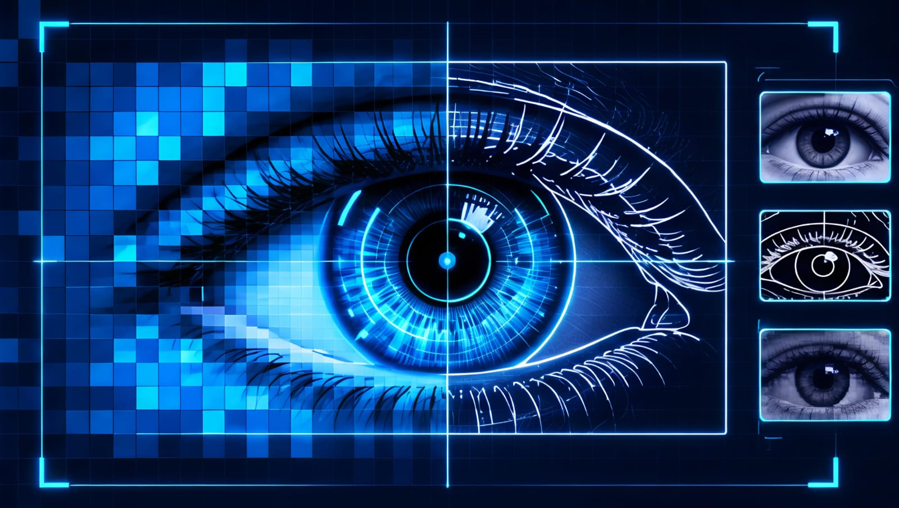
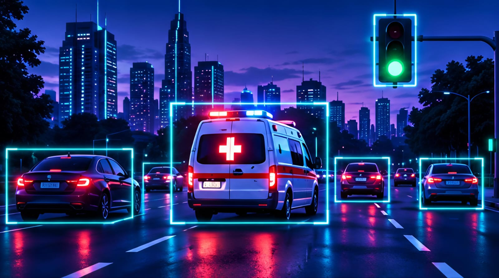
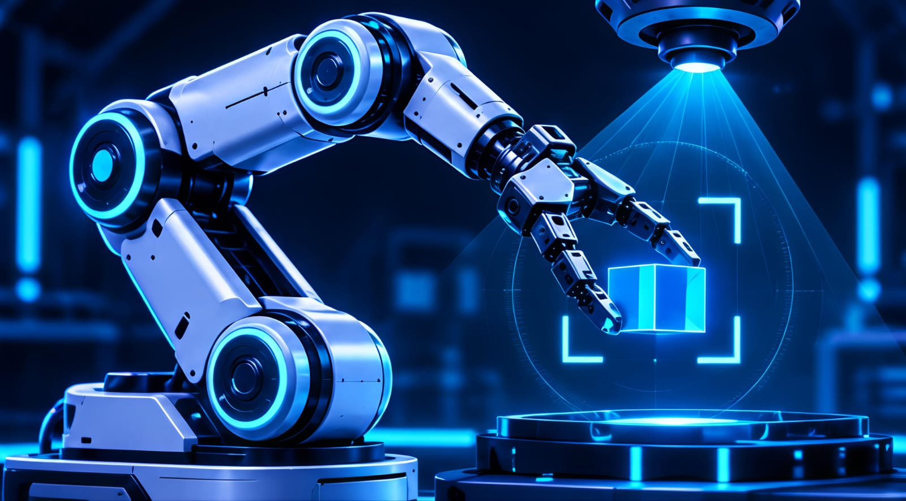
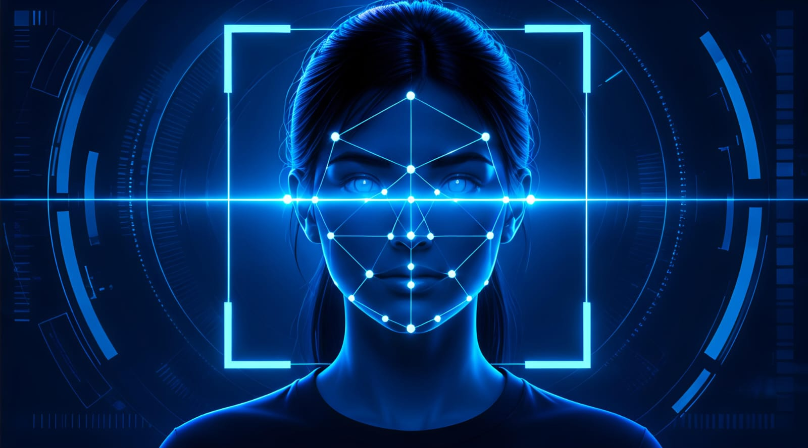
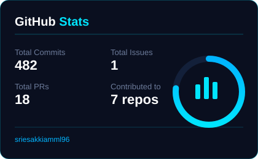

<table>
<tr>
<td width="68%" valign="top">

  
  

 

<h3>📁 Featured Projects</h3>

<table>
<tr>
<td align="center" width="25%">
 
<b>Image Processing with OpenCV</b> 🔵 Planned
</td>
<td align="center" width="25%">
 
<b>AI Ambulance Priority System</b> 🟣 Planned
</td>
<td align="center" width="25%">
 
<b>Robot Vision Simulation</b> 🟢 Future Goal
</td>
<td align="center" width="25%">
 
<b>Face Detection Demo</b> 🔵 Planned
</td>
</tr>
</table>

</td>

<td width="32%" valign="top" align="center">
  
<h3>📊 GitHub Stats</h3>

  

</td>

</td>
</tr>
</table>

<table>
<tr>
<td width="34%" valign="top" align="center">
<h3>🚀 Contribution Graph</h3>

 Learn • Build • Innovate • Automate ✨
</td>

<td width="33%" valign="top">
<h3>🎯 Learning Roadmap</h3>
✅ Strengthen Python Fundamentals 
✅ Learn Git &amp; GitHub 
⚪ Explore OpenCV 
⚪ Build Real Projects 
⚪ Explore Robotics &amp; ROS 2
</td>

<td width="33%" valign="top" align="center">
<h3>🌟 Connect With Me</h3>

  
<i>Let’s build something amazing together!</i>
</td>
</tr>
</table>
